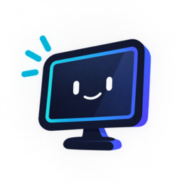
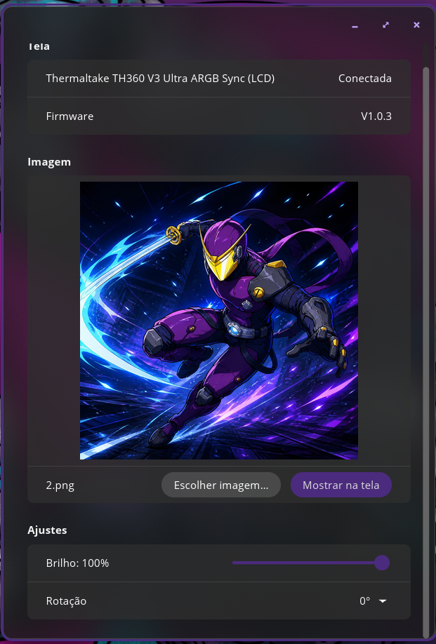

<p align="center">
  
</p>

<h1 align="center">Telinhas</h1>

<p align="center">
  Manage the mini screens of your PC on Linux, all in one place.<br>
  <a href="README.pt-BR.md">Leia em português</a>
</p>

> [!WARNING]
> **Early-stage project.** Telinhas currently supports **a single device**
> (see [Supported devices](#supported-devices)). Compatibility will grow with
> each update. Expect rough edges, and please report problems.

<p align="center">
  
</p>

## What it is

PCs are getting more and more small screens: AIO cooler displays, case panels,
USB mini monitors. Each brand ships its own Windows-only app. Telinhas aims to
manage all of them from a single Linux app, written in Rust, with a native
interface for the [COSMIC](https://system76.com/cosmic) desktop.

**Today you can:**

- show an image on the screen (automatically cropped to its resolution);
- adjust brightness and rotation;
- plug and unplug the screen while the app is open (it reconnects by itself).

**Planned:**

- support for more device models and brands;
- system information on the screen, such as CPU temperature and usage;
- running in the background and starting with the system;
- animations and video.

## Supported devices

| Device | USB ID | Status |
|---|---|---|
| Thermaltake TH360 V3 Ultra ARGB Sync (720×720 LCD) | `264a:2348` | Works (image, brightness, rotation) |

Other Thermaltake screens that use the same "BY" protocol may work with small
changes, but they have not been tested. If you own a different screen and want
to help, see [Contributing](#contributing).

## Install

Telinhas is distributed in two ways:

| Channel | Status | Updates |
|---|---|---|
| **AppImage** from [GitHub Releases](https://github.com/ninjairocode/telinhas-project/releases) | Available | Manual or with AppImageUpdate (see [Updating](#updating)) |
| **COSMIC Store** (Flatpak, via Flathub) | Coming soon | Automatic, through the store |

### AppImage

1. Download `Telinhas-x86_64.AppImage` from the
   [latest release](https://github.com/ninjairocode/telinhas-project/releases/latest).
2. Make it executable:
   ```
   chmod +x Telinhas-x86_64.AppImage
   ```
3. **Once:** allow access to the screen without root (udev rule), then unplug
   and plug the screen's USB cable back in:
   ```
   ./Telinhas-x86_64.AppImage udev-rules | sudo tee /etc/udev/rules.d/99-telinhas.rules
   sudo udevadm control --reload && sudo udevadm trigger
   ```
   If you skip this step, the app shows the command for you to copy.
4. Open it with a double click, or run `./Telinhas-x86_64.AppImage`.

**Requirements:** a 64-bit (x86_64) Linux with a Wayland or X11 desktop and
working graphics drivers (Vulkan or OpenGL). The interface is designed for
COSMIC but also runs on other desktops. If the AppImage fails to start with a
FUSE error (common in containers), run it with `--appimage-extract-and-run`.

### COSMIC Store

Coming soon. The app will be published on Flathub, which is the source the
COSMIC Store uses. The udev rule above will still be needed, because Flatpak
apps cannot install it on the system by themselves.

## Usage

### Graphical interface

1. Click **Choose image…** and pick a JPEG, PNG or WebP file. A preview shows
   how it will be cropped.
2. Click **Show on screen**.
3. Adjust **Brightness** (applied when you release the slider) and
   **Rotation**.

> [!NOTE]
> The screen only keeps a custom image **while Telinhas is running**: the app
> resends the image every 2 seconds, and the screen goes back to its own
> picture about 5 seconds after that stops. Minimizing the window is fine;
> closing it stops the image.

The interface is currently in Portuguese; translations are planned.

### Command line

The AppImage also works as a command-line tool when given arguments
(`telinhas` when built from source):

```
./Telinhas-x86_64.AppImage list                         # find supported screens
./Telinhas-x86_64.AppImage show photo.png --seconds 30  # show an image
./Telinhas-x86_64.AppImage show --color ff0000          # solid color
./Telinhas-x86_64.AppImage set --brightness 60 --rotate 90
./Telinhas-x86_64.AppImage prepare photo.png -o out.jpg # only convert, send nothing
./Telinhas-x86_64.AppImage probe                        # handshake, show versions
./Telinhas-x86_64.AppImage listen --seconds 10          # read-only debugging
```

`probe`, `show` and `set` send data to the device; add `--dry-run` to see the
bytes without sending them.

## Updating

| Installed via | How to update |
|---|---|
| **AppImage** | Download the new `Telinhas-x86_64.AppImage` from [Releases](https://github.com/ninjairocode/telinhas-project/releases/latest) and replace the old file (run `chmod +x` again). Or use [AppImageUpdate](https://github.com/AppImageCommunity/AppImageUpdate): `AppImageUpdate Telinhas-x86_64.AppImage` downloads only what changed. |
| **COSMIC Store / Flatpak** | Updates arrive through the store. From a terminal: `flatpak update`. |
| **Source** | `git pull`, then `cargo build --release` again. |

The udev rule does not need to be reinstalled when updating, unless the release
notes say so (for example, when a new device is added).

See [CHANGELOG.md](CHANGELOG.md) for what changed in each version.

## Build from source

Requires [Rust](https://rustup.rs) 1.93 or newer and, on Ubuntu/Debian/Pop!_OS:

```
sudo apt install libudev-dev libxkbcommon-dev libwayland-dev pkg-config
git clone https://github.com/ninjairocode/telinhas-project.git
cd telinhas-project
cargo build --release              # target/release/telinhas-gui and telinhas
cargo build --release -p telinhas  # command line only, without libcosmic
```

The first build downloads and compiles [libcosmic](https://github.com/pop-os/libcosmic)
and takes a few minutes. Install the udev rule from
`packaging/99-telinhas.rules` as shown in [AppImage](#appimage).

### Project layout

| Path | Contents |
|---|---|
| `crates/telinhas-core` | Device drivers, HID transport, protocols, image handling |
| `crates/telinhas` | Command-line tool |
| `crates/telinhas-gui` | COSMIC interface (libcosmic) |
| `packaging/` | udev rule, desktop entry, AppStream metadata, icons |
| `docs/PROTOCOL.md` | Notes on the Thermaltake "BY" protocol |

## Contributing

New devices are the most valuable contribution. Open an
[issue](https://github.com/ninjairocode/telinhas-project/issues) with the
screen model and the output of `lsusb`. Each device becomes a module in
`crates/telinhas-core/src/devices/`.

## Support

- Bugs and requests: [GitHub Issues](https://github.com/ninjairocode/telinhas-project/issues)
- E-mail: [ninjairocode@outlook.com](mailto:ninjairocode@outlook.com)

## License and legal notice

Telinhas is free software under the [GNU GPL v3.0 or later](LICENSE).

Device protocols were implemented from scratch, for interoperability only. This
repository contains no code, images or binaries from hardware vendors. Product
names are trademarks of their respective owners; Telinhas is not affiliated
with or endorsed by them.
