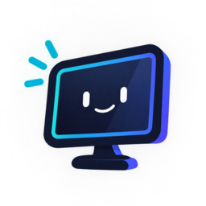
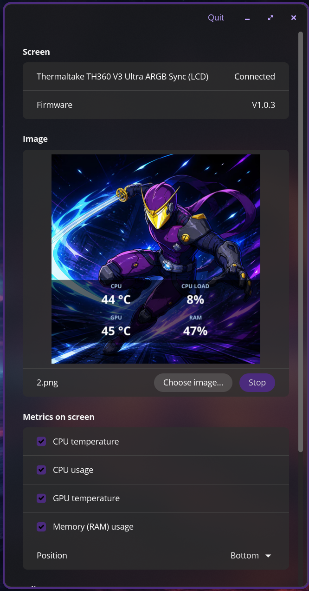

<p align="center">
  
</p>

<h1 align="center">Telinhas</h1>

<p align="center">
  Gerencie as mini telas do seu PC no Linux, num só lugar.<br>
  <a href="README.md">Read in English</a>
</p>

> [!WARNING]
> **Projeto em estágio inicial.** Por enquanto o Telinhas suporta **um único
> dispositivo** (veja [Dispositivos suportados](#dispositivos-suportados)). A
> compatibilidade vai aumentar a cada atualização. Espere algumas arestas e,
> por favor, relate os problemas.

<p align="center">
  
</p>

## O que é

Os PCs têm cada vez mais telinhas: visores de watercooler, painéis de gabinete,
mini monitores USB. Cada marca oferece o próprio app, quase sempre só para
Windows. O Telinhas quer gerenciar todas elas num único app para Linux, escrito
em Rust, com interface nativa para o desktop [COSMIC](https://system76.com/cosmic).

**Hoje você pode:**

- mostrar uma imagem ou um GIF animado na tela (recortado na resolução dela);
- desenhar métricas do sistema por cima: temperatura da CPU e da GPU, uso de
  CPU e de memória;
- ajustar brilho e rotação;
- manter o app em segundo plano e iniciá-lo com o sistema;
- conectar e desconectar a tela com o app rodando (ele reconecta sozinho).

**Planejado:**

- suporte a mais modelos e marcas;
- mais métricas e layouts;
- vídeo.

## Dispositivos suportados

| Dispositivo | ID USB | Estado |
|---|---|---|
| Thermaltake TH360 V3 Ultra ARGB Sync (LCD 720×720) | `264a:2348` | Funciona (imagem, GIF, métricas, brilho, rotação) |

Outras telas Thermaltake que usam o mesmo protocolo "BY" podem funcionar com
pequenos ajustes, mas não foram testadas. Se você tem outra tela e quer ajudar,
veja [Como contribuir](#como-contribuir).

## Instalação

O Telinhas é distribuído de duas formas:

| Canal | Estado | Atualizações |
|---|---|---|
| **AppImage** nas [Releases do GitHub](https://github.com/ninjairocode/telinhas-project/releases) | Disponível | Manual ou com AppImageUpdate (veja [Atualização](#atualização)) |
| **COSMIC Store** (Flatpak, via Flathub) | Em breve | Automáticas, pela loja |

### AppImage

1. Baixe o `Telinhas-x86_64.AppImage` da
   [última release](https://github.com/ninjairocode/telinhas-project/releases/latest).
2. Torne o arquivo executável:
   ```
   chmod +x Telinhas-x86_64.AppImage
   ```
3. **Uma vez só:** libere o acesso à tela sem root (regra udev) e depois
   desconecte e reconecte o cabo USB da tela:
   ```
   ./Telinhas-x86_64.AppImage udev-rules | sudo tee /etc/udev/rules.d/99-telinhas.rules
   sudo udevadm control --reload && sudo udevadm trigger
   ```
   Se você pular este passo, o app mostra o comando para copiar.
4. Abra com dois cliques ou rode `./Telinhas-x86_64.AppImage`.

**Requisitos:** Linux 64 bits (x86_64) com desktop Wayland ou X11 e drivers de
vídeo funcionando (Vulkan ou OpenGL). A interface foi feita para o COSMIC, mas
também roda em outros desktops. Se a AppImage não abrir por erro de FUSE (comum
em contêineres), rode com `--appimage-extract-and-run`.

### COSMIC Store

Em breve. O app será publicado no Flathub, que é a fonte usada pela COSMIC
Store. A regra udev acima continuará necessária, porque apps Flatpak não
conseguem instalá-la no sistema sozinhos.

## Uso

### Interface gráfica

A interface está em inglês; os nomes abaixo são os que aparecem na janela.

1. Clique em **Choose image…** e selecione um JPEG, PNG, WebP ou GIF
   (animado ou não). A prévia mostra como ele será recortado.
2. Em **Metrics on screen**, marque as métricas desejadas e escolha a
   **Position** (topo, meio ou embaixo; o meio funciona melhor em telas
   redondas). Sem imagem, as métricas aparecem sobre um fundo escuro.
3. Clique em **Show on screen**.
4. Ajuste **Brightness** (aplicado ao soltar o controle) e **Rotation**.

**Segundo plano:** fechar a janela não para a tela; o Telinhas continua
rodando. Abra-o de novo pelo menu de aplicativos para ver a janela, e use
**Quit** (barra superior) para encerrar. Ative **Start with the system** para
restaurar imagem, métricas e ajustes sempre que entrar na sessão.

> [!NOTE]
> A tela só mantém a imagem escolhida **enquanto o Telinhas estiver rodando**:
> o app continua enviando a imagem, e a tela volta à própria imagem uns
> 5 segundos depois que isso para (por exemplo, depois de **Quit**).

As configurações ficam em `~/.config/telinhas/`.

### Linha de comando

A AppImage também funciona como ferramenta de linha de comando quando recebe
argumentos (`telinhas`, se compilado do código-fonte):

```
./Telinhas-x86_64.AppImage list                         # procura telas suportadas
./Telinhas-x86_64.AppImage show foto.png --seconds 30   # mostra uma imagem
./Telinhas-x86_64.AppImage show anim.gif --metrics cpu-temp,ram-usage
./Telinhas-x86_64.AppImage show --color ff0000          # cor sólida
./Telinhas-x86_64.AppImage set --brightness 60 --rotate 90
./Telinhas-x86_64.AppImage prepare foto.png -o saida.jpg # só converte, não envia
./Telinhas-x86_64.AppImage probe                        # handshake; mostra versões
./Telinhas-x86_64.AppImage listen --seconds 10          # depuração, só leitura
```

`probe`, `show` e `set` enviam dados ao dispositivo; acrescente `--dry-run`
para ver o que seria enviado, sem enviar. Métricas: `cpu-temp`, `cpu-usage`,
`gpu-temp`, `ram-usage`; posição: `--metrics-position top|middle|bottom`. As
mensagens da linha de comando também estão em inglês.

## Atualização

| Instalado por | Como atualizar |
|---|---|
| **AppImage** | Baixe o novo `Telinhas-x86_64.AppImage` nas [Releases](https://github.com/ninjairocode/telinhas-project/releases/latest) e substitua o arquivo antigo (rode `chmod +x` de novo). Ou use o [AppImageUpdate](https://github.com/AppImageCommunity/AppImageUpdate): `AppImageUpdate Telinhas-x86_64.AppImage` baixa só o que mudou. |
| **COSMIC Store / Flatpak** | As atualizações chegam pela loja. Pelo terminal: `flatpak update`. |
| **Código-fonte** | `git pull` e depois `cargo build --release` de novo. |

Não é preciso reinstalar a regra udev ao atualizar, a menos que as notas da
versão digam o contrário (por exemplo, quando um dispositivo novo for
adicionado).

Veja o [CHANGELOG.md](CHANGELOG.md) para saber o que mudou em cada versão.

## Compilar do código-fonte

Requer [Rust](https://rustup.rs) 1.93 ou mais novo e, no Ubuntu/Debian/Pop!_OS:

```
sudo apt install libudev-dev libxkbcommon-dev libwayland-dev pkg-config
git clone https://github.com/ninjairocode/telinhas-project.git
cd telinhas-project
cargo build --release              # target/release/telinhas-gui e telinhas
cargo build --release -p telinhas  # só a linha de comando, sem o libcosmic
```

O primeiro build baixa e compila o [libcosmic](https://github.com/pop-os/libcosmic)
e leva alguns minutos. Instale a regra udev de `packaging/99-telinhas.rules`
como em [AppImage](#appimage).

### Organização do projeto

| Caminho | Conteúdo |
|---|---|
| `crates/telinhas-core` | Drivers, transportes, protocolos, imagens/GIFs, sensores, desenho das métricas |
| `crates/telinhas` | Ferramenta de linha de comando |
| `crates/telinhas-gui` | Interface COSMIC (libcosmic) |
| `packaging/` | Regra udev, atalho do menu, metadados AppStream, ícones |
| `packaging/flatpak/` | Manifesto Flatpak |
| `docs/PROTOCOL.md` | Notas sobre o protocolo "BY" da Thermaltake (em inglês) |
| `docs/ADDING_A_DEVICE.md` | Como adicionar uma tela nova (em inglês) |

### Flatpak

```
sudo apt install flatpak-builder python3-aiohttp python3-tomlkit python3-yaml
curl -O https://raw.githubusercontent.com/flatpak/flatpak-builder-tools/master/cargo/flatpak-cargo-generator.py
python3 flatpak-cargo-generator.py Cargo.lock -o packaging/flatpak/cargo-sources.json
flatpak-builder --user --install --install-deps-from=flathub --force-clean \
  build-dir packaging/flatpak/io.github.ninjairocode.Telinhas.yml
flatpak run io.github.ninjairocode.Telinhas
```

A fonte Noto Sans em `crates/telinhas-core/assets/fonts/` está sob a SIL Open
Font License 1.1 (`OFL.txt` ao lado dela).

## Como contribuir

A contribuição mais valiosa são dispositivos novos. Abra uma
[issue](https://github.com/ninjairocode/telinhas-project/issues) com o modelo
da tela e a saída do `lsusb`. Cada dispositivo vira um driver independente em
`crates/telinhas-core/src/devices/`; o passo a passo está em
[docs/ADDING_A_DEVICE.md](docs/ADDING_A_DEVICE.md) (em inglês).

## Suporte

- Bugs e pedidos: [GitHub Issues](https://github.com/ninjairocode/telinhas-project/issues)
- E-mail: [ninjairocode@outlook.com](mailto:ninjairocode@outlook.com)

## Licença e aviso legal

O Telinhas é software livre, sob a [GNU GPL v3.0 ou posterior](LICENSE).

Os protocolos dos dispositivos foram implementados do zero, apenas para
interoperabilidade. Este repositório não contém código, imagens ou binários dos
fabricantes. Os nomes de produtos são marcas de seus respectivos donos; o
Telinhas não é afiliado a eles nem endossado por eles.
